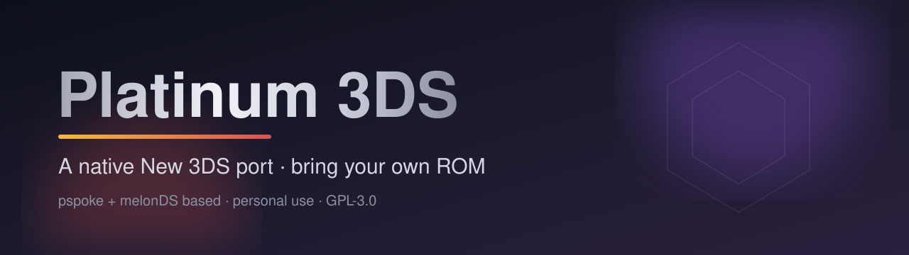

<p align="center">
  
</p>

<p align="center">
  <strong>Sinnoh, natively on the New 3DS.</strong><br/>
  A personal, fan-made native port of Pokémon Platinum (US, Rev 1).<br/>
  Sister of the <a href="https://github.com/unowncollectables/Pokemon-Soulsilver-New3ds">SoulSilver New 3DS</a> port · built from <em>your</em> legally dumped ROM.
</p>

<p align="center">
  
  
  
  <a href="LICENSE"></a>
</p>

<p align="center">
  <a href="https://github.com/unowncollectables/patch-builder/releases"></a>
  <a href="https://github.com/unowncollectables/3ds-platinum/commits/main"></a>
  <a href="https://github.com/unowncollectables/3ds-platinum/issues"></a>
  
</p>

<p align="center">
  <a href="#-features">Features</a> ·
  <a href="#-getting-started">Getting started</a> ·
  <a href="#%EF%B8%8F-settings-app">Settings</a> ·
  <a href="#-for-developers">Developers</a> ·
  <a href="#-credits">Credits</a>
</p>

> [!NOTE]
> **Independent project.** This port was made completely separately from, and independently of,
> [GabeSud0/pokeplatinum-3ds](https://github.com/GabeSud0/pokeplatinum-3ds). It is a different codebase, built on
> pspoke + melonDS rather than a port of the pret decomp. A few lower-menu ideas were borrowed later
> (see [Credits](#-credits)).

---

## 📖 What this is

A native **New Nintendo 3DS** port of Pokémon Platinum, built on [pspoke](https://github.com/IbrahimIrfan/pspoke) and the
pokeplatinum decompilation. It adds a 3DS platform layer (libctru / citro3d), a GPU 3D path, a GPU 2D compositor,
wide view, stereo 3D and an in-game settings app. New 3DS / New 3DS XL / New 2DS XL only (it needs the extra RAM and CPU cores).

> [!IMPORTANT]
> **Bring your own game.** You need your own legally dumped cartridge. This repository contains **no** ROMs, keys,
> saves, game assets or prebuilt builds. Not affiliated with Nintendo, Game Freak, Creatures or The Pokémon Company.
> Please do not ask for ROMs or builds.

---

## ✨ Features

| | What you get |
| :--- | :--- |
| 🖥️ **Wide view** | More of the world at the sides, plus wide battle and menu layouts. |
| 🕶️ **Stereo 3D** | Depth from the 3D slider through the GPU 3D path, with adjustable strength. |
| ⚡ **Smoother battles & speed tweaks** | Split-core top screen, fast upload / 3D convert, ROM cache, speed tweak levels. |
| 🔷 **Fast / Sharp 3D** | Optional 3D modes (Sharp 3D is still experimental on hardware). |
| 🔊 **Audio styles** | Clean, Light or DS Raw. |
| 💾 **Save backups & export** | Rotating `platinum.sav.bak1-3` at launch, plus an Export Save action with a read-back check. |
| 📡 **Wireless** | Local trading and play between ports over 3DS local wireless (UDS); online mode via the [Poké Classic Network](https://pkmnclassic.net/) community DNS (still in progress, see [`docs/WIRELESS.md`](docs/WIRELESS.md)). |
| ⚙️ **Settings app** | Press **L+R+Y** in game; every option has help text and is saved to `config.txt`. |
| ✨ **Shiny hunt tools** | Encounter counters, odds, shiny alert and hunt export. |
| 📱 **Lower menu** | Optional bottom-screen icon menu. |
| 🐾 **Extras** | HGSS-style following Pokémon (needs your own SoulSilver dump) and an animated 3D HOME Menu banner for the `.cia`. |

> [!TIP]
> Most new features are **toggles in the settings app and are off by default**. Every option is listed in
> [`platinum3ds/full/README_settings.txt`](platinum3ds/full/README_settings.txt).

---

## 🚀 Getting started

### What you need


- A New 3DS family console with custom firmware (Luma3DS) and the Homebrew Launcher (FBI for the `.cia`).
- **Your own dump** of Pokémon Platinum (US, Rev 1), SHA1 `0862ec35b24de5c7e2dcb88c9eea0873110d755c`.
  Optional: your own Pokémon SoulSilver (US) dump for following Pokémon sprites.
- About 10 GB of free disk. The first build takes an hour or more.

### 1. Easiest: Pokemon 3DS Builder (Windows)

Download **Pokemon3DSBuilder.exe** from the [patch-builder releases](https://github.com/unowncollectables/patch-builder/releases)
and run it. It installs the tools, checks your `.nds`, builds, and copies everything to your SD card (backing up your
save first). See the [patch-builder README](https://github.com/unowncollectables/patch-builder) for details.

> [!WARNING]
> **Windows SmartScreen:** if Windows says "Windows protected your PC", press **More info**, then **Run anyway**.
> This is normal for a new, unsigned download.

### 2. Or build by hand (Linux / WSL2)

1. Install [devkitPro](https://devkitpro.org/wiki/Getting_Started) (`sudo dkp-pacman -S 3ds-dev`), plus Python 3
   (`pip install ndspy pillow`), git, make and patch.
2. Put your ROM at `baserom/platinum_us_rev1.nds`.
3. Run the reference build script from patch-builder:

```sh
git clone https://github.com/unowncollectables/3ds-platinum.git ~/3ds-platinum
git clone https://github.com/unowncollectables/patch-builder.git ~/patch-builder
cd ~/patch-builder
sudo P3DS_ROOT=~/3ds-platinum bash p3ds_build.sh setup   # once
P3DS_ROOT=~/3ds-platinum P3DS_PLATINUM=/path/to/platinum.nds bash p3ds_build.sh all
```

That prepares pspoke with `pspoke-patches/`, runs `scripts/rebuild_all.sh`, applies `work_patches/`, then runs
`make` in `platinum3ds/full` (output: `platinum3ds_full.3dsx`). Run `make cia` there for the HOME Menu version.
`bash p3ds_build.sh check` lists anything missing.

### 3. SD card layout

```
sdmc:/3ds/platinum3ds/
    platinum3ds_full.3dsx   launch from the Homebrew Launcher
    platinum.nds            YOUR Platinum ROM
    platinum.sav            your save
    config.txt              settings (written by the settings app)
sdmc:/cias/platinum3ds.cia  optional HOME Menu version
```

---

## ⚙️ Settings app

Press **L+R+Y** in game (the game pauses). Up/down chooses, left/right or A changes, B or START closes. Changes are saved to `config.txt`; see [`README_settings.txt`](platinum3ds/full/README_settings.txt) for every key.

---

## 🛠️ For developers

### Repository layout

| Path | What |
|---|---|
| `platinum3ds/platform/` | 3DS platform layer: main loop, input, renderer, GPU 3D/2D, scaling, wireless |
| `platinum3ds/full/` | full-game link (`Makefile`, `README_settings.txt`) |
| `pspoke-patches/`, `patches/`, `work_patches/` | our changes on top of pspoke and the decomp (diffs only) |
| `toolchain-3ds/` | wrappers that make pspoke's build emit devkitARM objects |
| `followers/`, `forwarder/` | following Pokémon data and HOME Menu assets, extracted from YOUR ROMs |
| `docs/`, `PROGRESS.md` | notes and the development log |

---

## 🩺 Troubleshooting

- Only US Platinum Rev 1 works (not Rev 0, other regions, trimmed or patched files).
- Black screen at start: check `platinum.nds` is next to the `.3dsx` and that you are on a *New* 3DS / 2DS.
- Anything else: open an issue with `sdmc:/3ds/platinum3ds/log.txt`. Never attach ROMs or saves.

---

## 🙏 Credits

- [pspoke](https://github.com/IbrahimIrfan/pspoke): the base this port is built on.
- [melonDS](https://github.com/melonDS-emu/melonDS): the 2D renderer used via pspoke.
- [pret/pokeplatinum](https://github.com/pret/pokeplatinum): the Platinum decompilation.
- [GabeSud0/pokeplatinum-3ds](https://github.com/GabeSud0/pokeplatinum-3ds): some lower-menu and menu/layout ideas, borrowed later (this port was developed independently).
- The sister [SoulSilver New 3DS port](https://github.com/unowncollectables/Pokemon-Soulsilver-New3ds), where several
  features (wireless, speed tweaks, audio styles) came from.

See [`THIRD_PARTY.md`](THIRD_PARTY.md) for details and licences. Licensed under the **GNU GPL v3** ([`LICENSE`](LICENSE)).
