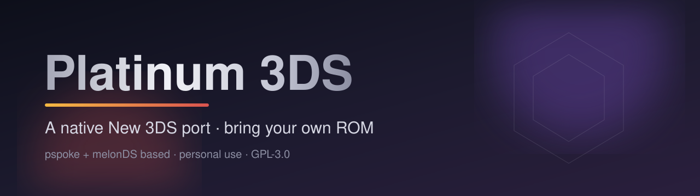

<p align="center">
  
</p>

<h1 align="center">Pokémon Platinum for New 3DS</h1>

<p align="center">
  Sinnoh in widescreen, with stereoscopic 3D, a GPU-drawn picture, following Pokémon, and an in-game settings app.
</p>

<p align="center">
  <a href="#setup"></a>
  &nbsp;
  <a href="LICENSE"></a>
  &nbsp;
  <a href="#status"></a>
  &nbsp;
  <a href="#new-from-soulsilver"></a>
  &nbsp;
  <a href="#settings"></a>
  &nbsp;
  <a href="https://discord.gg/wMVpZcK7X"></a>
</p>

<p align="center">
  <a href="https://github.com/unowncollectables/patch-builder/releases/latest"><strong>Download the Windows builder</strong></a>
  &nbsp;·&nbsp;
  <a href="#setup"><strong>Setup guide</strong></a>
  &nbsp;·&nbsp;
  <a href="#2-build-your-copy"><strong>Build instructions</strong></a>
  &nbsp;·&nbsp;
  <a href="#settings"><strong>Settings</strong></a>
  &nbsp;·&nbsp;
  <a href="https://discord.gg/wMVpZcK7X"><strong>Join the Discord</strong></a>
</p>

> [!IMPORTANT]
> **The SoulSilver sync has not been run on a 3DS yet.** Main now carries SoulSilver's platform layer and eight
> game-feature ports (battle Y screen, hunt stats, sharp text, Mobile PC, Black 2 sprites, wide GPU, GBA slot, livelier
> visible wilds, renderer speed-ups). They compile and link into `platinum3ds_full.elf`, and that is all that has been
> checked: none of it has been played on hardware or in an emulator. Keep a copy of your save off the SD card before
> trying a build from current main.

## Contents

<table>
  <tr>
    <td width="33%"><a href="#features">Features</a></td>
    <td width="33%"><a href="#about">About</a></td>
    <td width="33%"><a href="#new-from-soulsilver">New from SoulSilver</a></td>
  </tr>
  <tr>
    <td><a href="#setup">Setup</a></td>
    <td><a href="#settings">Settings</a></td>
    <td><a href="#black-2-battle-sprites-optional">Black 2 sprites</a> · <a href="#gba-slot-and-pal-park-optional">GBA slot</a></td>
  </tr>
  <tr>
    <td><a href="#wireless--online">Wireless &amp; online</a></td>
    <td><a href="#status">Status</a></td>
    <td><a href="#for-developers">For developers</a></td>
  </tr>
</table>

[Troubleshooting](#troubleshooting) · [Credits](#credits) · [Legal](#legal)

---

## Features

**Sinnoh on the 3DS's own hardware.** Platinum is compiled to run natively on the New 3DS. The 3DS GPU draws the 3D
world and most of the 2D picture, so there is room for widescreen, stereo depth, and extras the DS never had.

| | |
| --- | --- |
| **Wide View** | More of the overworld at the sides, plus wide battle and menu layouts across the full 400-pixel top screen. With the 3D slider up, the wide battle and menu layouts are drawn on the GPU for both eyes. |
| **Stereoscopic 3D** | Depth from the 3D slider in the field and in battles, with adjustable strength and a choice of battle depth styles (Gentle, Strong, Foe Deeper). |
| **GPU picture** | The GPU draws the 3D layer and composes both screens. SoulSilver's tuned speed setup (3D worker thread, in-between overworld frames, GPU fades) is the default. |
| **Following Pokémon** | Your lead (or any party slot) walks behind you, HGSS style, and can talk, cry, find items, and pop out of its ball. Needs a `followers.bin` made from your own SoulSilver dump. |
| **Settings app** | <kbd>L</kbd> + <kbd>R</kbd> + <kbd>Y</kbd> opens a touch settings app with help text for every row. Everything is saved to `config.txt`, never to the save. |
| **Hunting tools** | Encounter counter, shiny hunt suite, shiny odds, visible shiny sparkle, "Wild Pokémon here" for the current map, and a battle Y screen with catch odds. |
| **Quality of life** | Fast and auto-advance text, Repel prompt, IV/EV view on the summary, reusable TMs, HMs without learning, whole-party Exp. Share, auto-run, swap a catch into the party, touch quick menu and bottom icon menu. |
| **Distortion World** | Optional depth, drifting debris, camera roll, and an uneasy partner on the way to Giratina. |
| **Saves** | Your save stays a normal 512 KiB Platinum save. The port keeps a validated chain of up to eight backups and can export a checked copy from Settings. |
| **Wireless** | Union Room and Pokémon Center trades between two consoles running the port, over 3DS local wireless. Online GTS is in progress. |
| **HOME Menu** | An optional `.cia` with an animated 3D banner, alongside the Homebrew Launcher `.3dsx`. |

New in the SoulSilver sync, all **off** by default and all still untested on hardware:

- **A battle companion.** Press <kbd>Y</kbd> in battle for an overlay with wild info and catch odds, or the trainer's team, moves, PP, ability, and item. An optional page adds a rough damage and speed check. The battle keeps running.
- **Hunt stats on ZR.** <kbd>ZR</kbd> in the field opens the hunt stats as an overlay.
- **Sharp game text.** Every game text window, on both screens, drawn at the 3DS's own resolution instead of the stretched DS picture.
- **Mobile PC.** After the Hall of Fame, a **Boxes** tile in the Quick menu opens the PC boxes from the field.
- **Animated Black 2 sprites.** The Black 2 / White 2 sprites in battle and in every other Pokémon picture, from a pack made out of your own Black 2 dump.
- **A virtual GBA slot.** Migrate from a GBA game and Pal Park, read from your own GBA dump and a copy of its save.
- **Livelier visible wild Pokémon.** They pace, look around, come over to you, step aside for NPCs, and call out.

Details and the switch for each are under [New from SoulSilver](#new-from-soulsilver).

## About

**Pokémon Platinum for New 3DS** is a fan-made, native New Nintendo 3DS port of Pokémon Platinum (US, Rev 1). It is
built on [pspoke](https://github.com/IbrahimIrfan/pspoke) and the [pret/pokeplatinum](https://github.com/pret/pokeplatinum)
decompilation, retargeted from the PSP to the 3DS with devkitARM, with melonDS's renderer for the 2D engines. It is not a
DS emulator and not a ROM hack: the game is compiled for the 3DS and launched from the Homebrew Launcher, or installed as
a `.cia` on the HOME Menu, on a New 3DS, New 3DS XL, or New 2DS XL with custom firmware (Luma3DS). It needs the New 3DS's
extra memory and CPU cores.

It is the sister of the [HeartGold &amp; SoulSilver New 3DS port](https://github.com/unowncollectables/Pokemon-Soulsilver-New3ds).
The two share one platform layer: it started here, SoulSilver forked it in October 2026, and the November 2026 sync
brought SoulSilver's version back (see [For developers](#for-developers)).

> [!NOTE]
> **Independent project.** This port was made separately from, and independently of,
> [GabeSud0/pokeplatinum-3ds](https://github.com/GabeSud0/pokeplatinum-3ds). It is a different codebase. A few
> lower-menu and layout ideas were borrowed later (see [Credits](#credits)).

This repository holds source code, patches, tooling, and documentation. It contains no ROMs, keys, extracted game data,
saves, or prebuilt builds. You build your own copy from a legally dumped Platinum cartridge you own. Please do not ask
for ROMs or builds.

## New from SoulSilver

Each feature below is a game-side port of a SoulSilver hook onto Platinum's own code. Every one has a settings row that
starts **OFF**, none of them writes to the save, and none has been run on a 3DS or an emulator yet: each was checked by
compiling the patched code and linking the game. The full mapping, hook by hook, is in
[`docs/SOULSILVER_SYNC.md`](docs/SOULSILVER_SYNC.md).

### Battle Y screen and damage check

| Settings row | Key | Tab |
| --- | --- | --- |
| Catch info (Y) | `catch_overlay` | Hunt |
| Damage check (Y) | `dmg_check` | Hunt |

With **Catch info (Y)** on, <kbd>Y</kbd> in battle opens SoulSilver's battle screen as an overlay while the battle keeps
running. In a wild battle it shows the Pokémon's info, catch odds, and a hunt page; in a trainer battle it shows the
foe's moves, PP, ability, and item, and its team's HP. **Damage check (Y)** adds a rough damage and speed page (singles
only). The lower menu and bottom strip hide while the overlay is up, and <kbd>Y</kbd> in battle no longer opens the
settings app.

### Hunt stats on ZR

| Settings row | Key | Tab |
| --- | --- | --- |
| Hunt stats on ZR | `hunt_stats` | Hunt |

<kbd>ZR</kbd> in the field opens the hunt stats overlay. It needs **Encounter counter** (`hunt_counter`) on, and because
<kbd>ZR</kbd> is the item button by default, also turn off **ZR = item (Y)** on the Keys tab. The numbers live in
`hunt.txt`, next to `config.txt`, never in the save.

### Sharp game text

| Settings row | Key | Tab |
| --- | --- | --- |
| Sharp game text | `sharp_game_text` | Video |

Every game text window on both screens is drawn at the 3DS's resolution. It needs a scale mode (**1.25X** or **FILL**)
and applies to text already on screen when you toggle it. SoulSilver ships this on; Platinum starts it **OFF** until it
has been seen on hardware. If text goes missing or looks doubled, turn it off.

### Mobile PC

| Settings row | Key | Tab |
| --- | --- | --- |
| Mobile PC (Boxes) | `mobile_pc` | Game |
| Mobile PC before League | `mobile_pc_dev` | Debug (testing only) |

Once you are in the Hall of Fame, the Quick menu gets a **Boxes** tile. It fades out, opens the game's own PC box app
(Move Pokémon, as at a Pokémon Center PC), and brings you back to the field. It is not offered in the Mystery Zone,
Great Marsh, Pal Park, or Distortion World. It only reads the Hall of Fame flag. Platinum has no SoulSilver party-screen
chip, so the Quick menu tile replaces it, and SoulSilver's one-time unlock fanfare is not ported.

### Black 2 sprites

| Settings row | Key | Tab |
| --- | --- | --- |
| Black 2 sprites | `b2_sprites` | Video |

See [Black 2 battle sprites](#black-2-battle-sprites-optional) below.

### Wide on GPU

| Settings row | Key | Tab | Starts as |
| --- | --- | --- | --- |
| Wide on GPU | `wide_gpu` | Debug | **SLIDER UP** (on whenever the 3D slider is up) |

Platinum's own GPU wide layout for battles and menus was dropped in the first half of the sync and is back, now on
SoulSilver's compositor. With the 3D slider up, wide battle and menu frames are drawn on the GPU for both eyes. Wide
frames always wait for their own draw (no in-between frame or overlap), rotated or scaled sprites send the frame to the
CPU wide path, and Foe Deeper's per-row shift is not applied on wide frames. **ALWAYS** also uses it with the slider
down; **OFF** uses the CPU wide path. This is the one new row that starts on, because it restores Platinum's behaviour
from before the sync.

### GBA slot and Pal Park

| Settings row | Key | Tab |
| --- | --- | --- |
| GBA slot | `slot2` | Game |
| GBA pak | `slot2_pak` | Game |

See [GBA slot and Pal Park](#gba-slot-and-pal-park-optional) below.

### Livelier visible wild Pokémon

| Settings row | Key | Tab |
| --- | --- | --- |
| Wild Pokémon behave | `wild_vis_alive` | Hunt |
| Wild Pokémon call | `wild_vis_cries` | Hunt |

Platinum keeps its own visible wild Pokémon (`wild_vis`, grass only, drawn by the port) and gains the parts of
SoulSilver's that fit it. Whenever **Visible wild Pokémon** is on, they no longer walk onto people or each other, step
aside or slip away when an NPC walks onto them, and spawn from the clock, so they differ after a Continue. With **Wild
Pokémon behave**, each one gets a pace (calm, lazy, or lively), looks around, curious ones come over and stop beside you
when you stand still, lively ones step away as you approach, and they go home when the time of day changes. With **Wild
Pokémon call**, those within seven tiles call now and then, panned and quieter with distance.

Not ported: herds and families, alarm calls, rain species and splashes, chases, cave fly-bys, surf and shore wilds, the
Safari Zone, and scattering after a battle (Platinum's visible wilds all leave when a battle starts).

### Renderer speed-ups

Always on, with no setting. Two of SoulSilver's renderer patches: sprites are bucketed by priority in one pass per
scanline, and the display-list cache probes a packed key array. The picture is the same; the CPU does less work. The
speed gain has been measured in SoulSilver's profile, not on Platinum.

### Not ported

SoulSilver's Pokégear encounter finder and its slot chances are Johto map screens. Platinum's settings **Wild Pokémon
here** page already lists the current map's species with level ranges and chances per method, and the game's own Pokédex
area map covers the rest.

## Setup

Build from your own US Platinum dump. The repository has no ROM in it. If you already play this port, copy your save off
the SD card before replacing the build.

### 1. Check your kit

| You need | |
| --- | --- |
| Console | New Nintendo 3DS, New 3DS XL, or New 2DS XL with custom firmware (Luma3DS) and the Homebrew Launcher. FBI for the `.cia`. See the [3DS Hacks Guide](https://3ds.hacks.guide/). |
| Game | Your own dump of Pokémon Platinum (US, Rev 1), SHA-1 `0862ec35b24de5c7e2dcb88c9eea0873110d755c`. Rev 0, other regions, trimmed or patched files will not work. |
| Optional | Your own Pokémon SoulSilver (US) dump for following Pokémon, your own Black 2 (US) dump for animated sprites, your own GBA dump and save for the GBA slot. |
| PC | About 10 GB of free disk. The first build takes an hour or more. |

### 2. Build your copy

On **Windows 10/11**, download **Pokemon3DSBuilder.exe** from the
[patch-builder releases](https://github.com/unowncollectables/patch-builder/releases/latest) and choose your Platinum
`.nds`. It installs the tools, checks the dump, builds, and can copy everything to the SD card, backing up your save
first. See the [patch-builder README](https://github.com/unowncollectables/patch-builder) for details.

> [!WARNING]
> **Windows SmartScreen:** if Windows says "Windows protected your PC", press **More info**, then **Run anyway**. This
> is normal for a new, unsigned download.

<details>
<summary><strong>Build by hand on Linux or WSL2</strong></summary>

Install [devkitPro](https://devkitpro.org/wiki/Getting_Started) (`sudo dkp-pacman -S 3ds-dev`), Python 3 with
`ndspy` and `pillow`, Git, make, and patch. Keep the ROM outside the clone.

```sh
git clone https://github.com/unowncollectables/3ds-platinum.git ~/3ds-platinum
git clone https://github.com/unowncollectables/patch-builder.git ~/patch-builder
cd ~/patch-builder
sudo P3DS_ROOT=~/3ds-platinum bash p3ds_build.sh setup   # once
P3DS_ROOT=~/3ds-platinum P3DS_PLATINUM=/path/to/platinum.nds bash p3ds_build.sh all
```

That prepares pspoke with `pspoke-patches/`, runs `scripts/rebuild_all.sh`, applies `work_patches/`, then runs `make`
in `platinum3ds/full` (output: `platinum3ds_full.3dsx`). Run `make cia` there for the HOME Menu version.
`bash p3ds_build.sh check` lists anything missing.

</details>

### 3. Launch on the console

Put your dump at `sdmc:/3ds/platinum3ds/platinum.nds`.

| Launch | Where the program goes |
| --- | --- |
| Homebrew Launcher | Copy `platinum3ds_full.3dsx` into `sdmc:/3ds/platinum3ds/`. |
| HOME Menu | Copy `platinum3ds.cia` to `sdmc:/cias/` and install it with FBI. It uses the same folder, save, and settings as the `.3dsx`. |

<details>
<summary><strong>Save files and SD card layout</strong></summary>

Platinum uses these files in `sdmc:/3ds/platinum3ds/`.

| File | Role |
| --- | --- |
| `platinum.nds` | Your US Rev 1 cartridge dump. The game only reads it. |
| `platinum.sav` | The 512 KiB save, a normal Platinum save. |
| `platinum.sav.bak1` … `.bak8` | Validated rotating backups, made at launch, about 2 seconds after each in-game save, and at exit. |
| `export/` | Checked copies made by **Export save** in Settings. |
| `config.txt` | Settings. Delete a line to return that key to its built-in default. |
| `hunt.txt` | Encounter and hunt counters. Separate from the save. |
| `followers.bin` | Following Pokémon sprites, made from your own SoulSilver dump. Optional. |
| `b2sprites.bin` | Black 2 sprite pack, made from your own Black 2 dump. Optional. |
| `slot2/`, `slot2-work/` | Your GBA dumps and saves, and the working copies the game writes. Optional. |
| `prefetch.bin` | What zone prefetch has learned. Safe to delete. |
| `log.txt` | The current run log. `log_crash.txt` keeps the log from an unclean exit, `log_prev.txt` the last clean one. |

To bring in a cart, flashcart, or emulator save, copy it over `platinum.sav` (keep a copy of the old one first). There
is no import step.

</details>

## Black 2 battle sprites (optional)

The port can swap the Pokémon sprites for the animated ones from Black 2 / White 2. It is off by default.

1. Make the sprite pack from your own US Black 2 dump with the builder's **Black 2 sprites** step (SoulSilver's
   `tools/b2sprites/build_pack.sh`). This repository contains none of Black 2's art.
2. Put the pack at `sdmc:/3ds/platinum3ds/b2sprites.bin`. If that folder has none, the game uses
   `sdmc:/3ds/soulsilver3ds/b2sprites.bin`, so one pack can serve both ports.
3. In the game, open Settings (<kbd>L</kbd> + <kbd>R</kbd> + <kbd>Y</kbd>) → Video → **Black 2 sprites**.

In battle the sprites are full size, move more slowly at yellow or red HP, and hold still while asleep or frozen. Every
other Pokémon picture uses them too, fitted into the game's 80×80 box. The pack is read once per battle; without it, the
game's own sprites are used. The DP-style pictures that a few screens ask for keep the game's art. Not yet seen on
Platinum in an emulator or on hardware.

## GBA slot and Pal Park (optional)

A virtual GBA game pak in the DS's GBA slot, as on a DS Lite, so the game's own **Migrate from** and Pal Park work. It is
off by default.

1. Put your own GBA ROM dump and its save in `sdmc:/3ds/platinum3ds/slot2/` as `<name>.gba` and `<name>.sav`.
2. In Settings → Game, turn on **GBA slot**. **GBA pak** picks which `.gba` is in the slot (1 = first by name).
3. Restart or soft reset: the main menu checks the slot at start.

The first time, the save is copied to `slot2-work/<name>.sav`, and the game only ever reads and writes that copy. Your
original `.sav` is never written. **Migrate from** appears on the main menu once you have the National Pokédex and the
GBA game is the same language. A pak in the slot also turns on Platinum's own GBA-slot wild Pokémon, as a real pak does.
SoulSilver's continue-menu GBA SLOT button is not ported; the pak is chosen in Settings instead. Not yet tried in an
emulator or on hardware.

## Settings

Open Settings with <kbd>L</kbd> + <kbd>R</kbd> + <kbd>Y</kbd>, or touch and hold the top-left corner of the bottom
screen in the field. The game pauses while it is open.

| | |
| --- | --- |
| Browse | <kbd>L</kbd> and <kbd>R</kbd>, or tap a tab. Up and down choose a row; the top screen shows its help line. |
| Change | <kbd>←</kbd> <kbd>→</kbd> or <kbd>A</kbd>, or tap the row. |
| Debug tab | Press <kbd>SELECT</kbd> inside the app to show or hide it. |
| Apply and save | Close with <kbd>B</kbd>, <kbd>START</kbd>, or <kbd>L</kbd> + <kbd>R</kbd> + <kbd>Y</kbd>. Changes are written to `config.txt`. |

**Updating from an older build?** A line already in `config.txt` wins over a new default, so your existing settings
carry over as they are. To start from the current defaults, close the game, keep a copy of `config.txt`, remove it from
the folder, and relaunch. This resets settings only; leave your `.sav` in place.

<details>
<summary><strong>Tabs and rows</strong></summary>

Rows marked **new** came with the SoulSilver sync.

| Tab | Rows |
| --- | --- |
| Video | FPS counter, Wide view, Wide menu layouts, Scale, **Sharp game text** (new), **Black 2 sprites** (new), 3D strength, Battle 3D depth, Camera zoom, Time-of-day tint, Weather in strips, Distortion 3D depth, Distortion debris, Distortion camera roll, Uneasy Pokémon, Distant cry |
| Game | Fast text, Hold B: fast text, Auto-advance text, Battle anim speed, Repel prompt, IV/EV on summary, Reusable TMs, HMs without learning, Hidden item ping, Save backups, Menu music, Local wireless (test), Exp. Share: whole party, Auto-run, Swap catch into party, **Mobile PC (Boxes)** (new), **GBA slot** (new), **GBA pak** (new) |
| Keys | C-stick, ZL run toggle, ZR = item (Y), Circle pad D-pad, Touch quick menu, Bottom button strip, Bottom icon menu, Quick menu |
| Pal | Following Pokémon, Follower slot, Follower talk, Follower cry, Finds items, Emote bubbles, Ball pop-out, Area talk, Friendship talk, Idle look-around, Follower gap, Behind player |
| Hunt | Hunt stats (page), Wild Pokémon here (page), Shiny hunt suite, Skip intro on reset, Hold SELECT = reset (battle), Encounter counter, Catch info (Y), **Damage check (Y)** (new), **Hunt stats on ZR** (new), Visible wild Pokémon, Visible wild max, Only visible battle, **Wild Pokémon behave** (new), **Wild Pokémon call** (new), Shiny odds, Visible shiny sparkle, Low battery warning |
| Cheats | No wild encounters, Infinite money, Always catch, Shiny wild, Fast eggs, EXP boost, Rare Candy 99, Infinite PP, Fast running (B), Walls: hold R, Time of day |
| Debug | Speed, compose and logging switches, including **Wide on GPU** (back on the new compositor) and **Mobile PC before League** (new) |

Wireless is now automatic (see [Wireless &amp; online](#wireless--online)); the **Local wireless (test)** row is left
over from before the sync and no longer changes anything.

</details>

<details>
<summary><strong>Built-in defaults</strong></summary>

A missing `config.txt` line uses the `kCfgDefaults` table in `platinum3ds/platform/psp_ctru.c` if it lists the key, and
otherwise the settings app's own default. A line already in the file always wins, including OFF. The
[settings reference](platinum3ds/full/README_settings.txt) lists every key; where it and the code disagree, the code is
what the game reads.

The sync brought over only SoulSilver's platform, speed, and display defaults. Anything that changes Platinum's gameplay
keeps Platinum's own default, so an existing `config.txt` plays as before.

| If this line is missing | It starts as |
| --- | --- |
| Sharp game text (`sharp_game_text`) | OFF |
| Black 2 sprites (`b2_sprites`) | OFF |
| Mobile PC (`mobile_pc`, `mobile_pc_dev`) | OFF |
| GBA slot (`slot2`), GBA pak (`slot2_pak`) | OFF, pak 1 |
| Catch info (Y), Damage check (Y), Hunt stats on ZR | OFF |
| Wild Pokémon behave, Wild Pokémon call | OFF |
| Wide on GPU (`wide_gpu`) | SLIDER UP (on with the 3D slider up) |
| Sharp panel text (`sharp_text`) | ON |
| Wide menu layouts (`wide_layouts`) | ON |
| 60 fps field (`fps60` and its parts) | ON, with SoulSilver's tuned speed setup (3D worker thread, packets, transform cache, stereo right eye on the GPU) |
| Second screen GPU (`gpu_compose_b`), GPU sprite rotation (`gpu_obj_affine`), GPU fades (`gpu_b_fades`) | ON |
| Speed tweaks (`fps_tweaks`) | L7 |
| Sharp 3D (`g3_sharp`) | FAST AUTO |
| FPS counter | OFF |
| Save backups | ON (eight-deep validated chain) |
| Audio style | DS RAW |
| Cheats, visible wild Pokémon, following Pokémon | OFF |

</details>

## Wireless &amp; online

| Path | In short |
| --- | --- |
| Automatic | No setting. Turn the 3DS wireless on and play. When the game starts local wireless (Union Room, Pokémon Center 2F, Underground with friends), the port uses 3DS-to-3DS local wireless; online services use the internet. The log shows `[WIRELESS] auto -> LOCAL` when it switches. |
| Local | Trades and battles between two consoles running the port. A real DS cartridge can't join this 3DS session. |
| Online | Community-server GTS through the [Poké Classic Network](https://pkmnclassic.net/) DNS, with SoulSilver's StarMe server picker (`gts_picker`). Still in progress on Platinum. |

Test wireless with copies of your save on both consoles: a trade writes the save through the game's own code. See the
[wireless guide](docs/WIRELESS.md).

## Status

**In active development.** Before the sync, the port was played on a New 3DS: the core game, wide view, stereo 3D, and
the GPU compositor have run on hardware across many test runs, logged in
[`PROGRESS.md`](PROGRESS.md). On 25 November 2026, SoulSilver's platform layer and eight game-feature ports were merged
into main. That merge has been compiled and linked only. **None of it has been run on a 3DS or in an emulator yet**, so
treat current main as untested.

When [reporting an issue](https://github.com/unowncollectables/3ds-platinum/issues), include your console model and
`log.txt` or `log_crash.txt` from `sdmc:/3ds/platinum3ds/`. Never attach ROMs or saves.

**Discord.** Ask for help and post bug reports as pasted text on [Unown Collectables](https://discord.gg/wMVpZcK7X). No
ROMs, dumps, BIOS files, keys, or saves.

<details>
<summary><strong>Recent changes · November 2026</strong></summary>

- **SoulSilver platform layer:** the overworld 60 fps path, the 3D worker thread, GPU compose for the second screen,
  exact fades, sharp panel text, H-blank line scrolls (the water battle intro no longer crashes), the DS-exact audio
  mixer timing and DSP watchdog, a safer soft-reset order, a crash screen, and automatic wireless. Platinum keeps its own
  save backup chain, wide layouts, settings app, lower menu, and follower overlays.
- **Battle Y screen and damage check**, **hunt stats on ZR**, **sharp game text**, **Mobile PC**, **Black 2 sprites**,
  **GBA slot / Pal Park**, **livelier visible wilds**, and **renderer speed-ups**, as described under
  [New from SoulSilver](#new-from-soulsilver).
- **Wide on GPU** restored on SoulSilver's compositor.
- `P3DS_InBattle` is now set from the first frame of every battle, not only once a wild battle's command menu opens.

</details>

<details>
<summary><strong>Experimental features and known issues</strong></summary>

- **Everything from the SoulSilver sync.** Compiled and linked only. Each feature has its own switch and starts OFF
  (except Wide on GPU, which restores the old behaviour). If something breaks, turn that row off or delete its line from
  `config.txt`.
- **60 fps and speed defaults.** These are SoulSilver's tuned values. Their frame rates were measured on SoulSilver
  hardware, not on Platinum.
- **Sharp game text.** Off until it has been seen on hardware. Needs 1.25X or FILL scale.
- **Wide on GPU.** Rotated or scaled sprites fall back to the CPU wide path; Foe Deeper's per-row depth is not applied on
  wide frames.
- **GBA slot.** The pak is picked in Settings and only read at start or after a soft reset.
- **Sharp 3D.** The 2× "sharp" mode was disabled on Platinum hardware in run 52; leave it alone unless testing.
- **Online GTS.** In progress.

See [`docs/HANDOFF.md`](docs/HANDOFF.md) and [`PROGRESS.md`](PROGRESS.md) for test notes and the run-by-run log.

</details>

## Troubleshooting

- Only US Platinum Rev 1 works (not Rev 0, other regions, trimmed or patched files).
- Black screen at start: check that `platinum.nds` is in `sdmc:/3ds/platinum3ds/` and that you are on a *New* 3DS or
  New 2DS XL.
- Something looks or sounds wrong after a settings change: delete that line from `config.txt`, or the whole file.
- A new SoulSilver feature misbehaves: turn its row off (see [New from SoulSilver](#new-from-soulsilver)) and send the
  log.

## For developers

The port compiles the [pret/pokeplatinum](https://github.com/pret/pokeplatinum) decompilation through
[pspoke](https://github.com/IbrahimIrfan/pspoke), retargeted to devkitARM. `psp_*` names in the code are shims over
libctru and citro3d. Read [`AGENTS.md`](AGENTS.md) first, and [`PROGRESS.md`](PROGRESS.md) before changing audio,
threads, 3D, or save code.

<details>
<summary><strong>Repository layout</strong></summary>

| Path | What |
| --- | --- |
| `platinum3ds/platform/` | 3DS platform layer, shared with SoulSilver: main loop, input, renderer, GPU 3D and 2D, wide layouts, settings app, wireless, Slot 2, Black 2 sprites |
| `platinum3ds/full/` | Full-game link (`Makefile`) and [`README_settings.txt`](platinum3ds/full/README_settings.txt), the reference for every key |
| `pspoke-patches/` | Commits on pspoke (base in `BASE_COMMIT`) |
| `patches/`, `work_patches/` | Diffs of the generated tree (pokeplatinum names). `work_patches/overlays/` holds the game-side changes, `work_patches/native/` the renderer changes |
| `toolchain-3ds/` | Wrappers that make pspoke's build emit devkitARM objects |
| `followers/`, `forwarder/` | Following Pokémon extractor and HOME Menu assets, both built from your own ROMs |
| `scripts/`, `tools/` | Build scripts, the headless Azahar harness (`tools/emu_smoke.sh`), and save checks |
| `docs/` | [SoulSilver sync](docs/SOULSILVER_SYNC.md), [wireless](docs/WIRELESS.md), and [handoff](docs/HANDOFF.md) notes |

</details>

<details>
<summary><strong>How the SoulSilver sync was done</strong></summary>

The platform layer started in this repository. SoulSilver forked it on 25 October 2026 (Platinum run 80, `0e374ca`) and
went on for about 500 commits. **Phase 1** brought SoulSilver's layer back with a three-way merge against that fork
point, so Platinum's own later work (wide layouts, `wide_gpu`, frame pacing, follower hooks, lower menu, settings app)
was kept where it still applied. A few files were adapted rather than copied:

- `p3ds_ssglue.c` answers the hooks the shared layer expects. Zero means "that SoulSilver-only screen never happens here".
- `gpucomp.c` is SoulSilver's compositor. `frame_pacing` is replaced by its overlap path, `gpu_mbright` and
  `gpu_blend_3d` by speed tweak levels 3 and 4, and `wide_gpu` was re-ported onto it in phase 2.
- `widecomp.c` stays Platinum's, with `WC_StripHash` and `WC_MapColumn` added for sharp game text.
- `render3ds.cpp` takes SoulSilver's frame pipeline and keeps Platinum's settings app, wide layout engine, lower menu,
  bottom strip, and follower overlays.
- Save backups stay Platinum's: SoulSilver's chain validates HGSS save footers, so it is not used.

**Phase 2** ported the game features. SoulSilver's game hooks are Python scripts that edit pokeheartgold sources;
Platinum has no hook runner, so each one became a unified diff of the matching generated pokeplatinum source under
`work_patches/overlays/`. Each feature was its own stacked branch and is listed hook by hook in
[`docs/SOULSILVER_SYNC.md`](docs/SOULSILVER_SYNC.md). New settings rows past index 33 need a `kGenDef` entry in
`render3ds.cpp`.

</details>

## Credits

- [unowncollectables](https://github.com/unowncollectables) leads the project and tests on hardware.
- [IbrahimIrfan/pspoke](https://github.com/IbrahimIrfan/pspoke) is the base this port is built on.
- [pret/pokeplatinum](https://github.com/pret/pokeplatinum) is the Platinum decompilation.
- [melonDS](https://github.com/melonDS-emu/melonDS) provides the 2D renderer, used through pspoke.
- The sister [HeartGold &amp; SoulSilver New 3DS port](https://github.com/unowncollectables/Pokemon-Soulsilver-New3ds)
  is where the shared platform layer grew up and where every feature in the November 2026 sync came from.
- [GabeSud0/pokeplatinum-3ds](https://github.com/GabeSud0/pokeplatinum-3ds) inspired some lower-menu and menu layout
  ideas, borrowed later; this port was developed independently.
- [devkitPro](https://devkitpro.org/), libctru, citro3d, and [Azahar](https://azahar-emu.org/) provide tooling for
  development and testing. Claude, Grok Bot, and Codex contributed code, tooling, and documentation.
- Thanks to everyone who tests builds and shares logs. See [`THIRD_PARTY.md`](THIRD_PARTY.md) for full attributions and
  licences.

## Legal

This unofficial, personal-use fan project is licensed under the [GNU GPL v3](LICENSE). You supply the original game data
by dumping your own US Platinum cartridge (and, for the optional extras, your own SoulSilver, Black 2, and GBA
cartridges). The repository contains source code and documentation only. Game assets and trademarks belong to their
respective owners. Nintendo, Game Freak, Creatures, and The Pokémon Company have no affiliation with this project.
